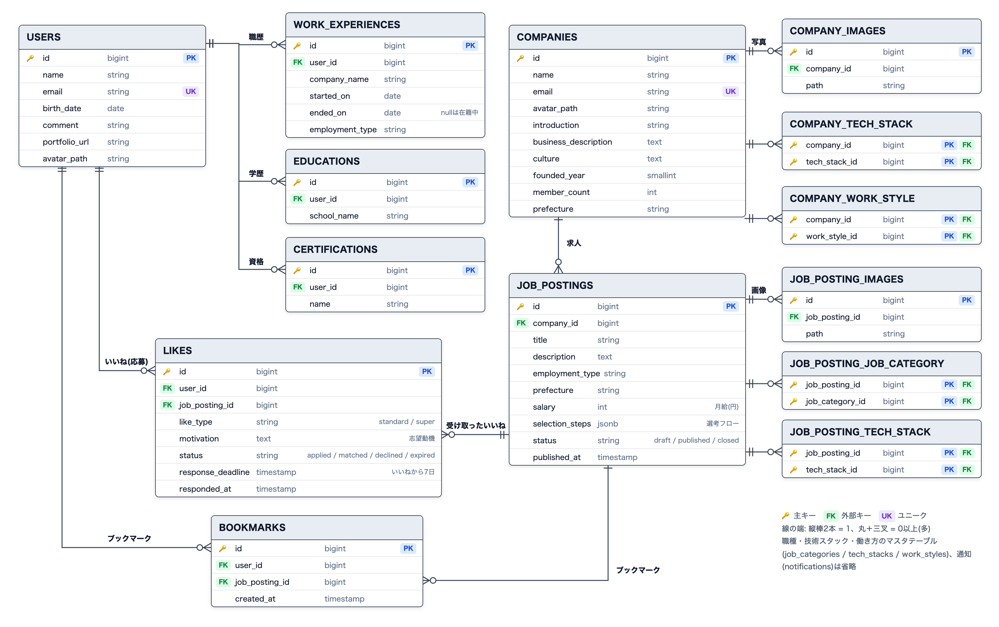

# Tech Match

Laravel + Next.js 構成の、IT・エンジニア職に特化した求人マッチングサービスです。Wantedlyをモデルに機能を絞り、マッチングアプリの仕組み(いいね=応募、回数制限、返事の期限)を取り入れています。

## デモ

- 公開ページ: https://frontend-production-2e986.up.railway.app

ログイン画面の「デモ用アカウントを入力」ボタンから、そのままログインできます。

| 種類 | メールアドレス | パスワード | 入っている状態 |
| --- | --- | --- | --- |
| 求職者 | demo-seeker@example.com | password1234 | 応募(反応待ち・マッチ・見送り・期限切れ)、ブックマーク、通知。今月のいいねが残っているので、実際にいいねも試せる |
| 企業 | demo-company@example.com | password1234 | 公開中・下書き・募集終了の求人、反応待ち(期限が近いものを含む)・マッチ・不成立の応募者、通知 |

デモ用のデータ(企業16社・求人46件・求職者16人)は`php artisan db:seed`で作り直せます。

## ER図



- `likes`は「同じ求職者×同じ求人で、期限切れ以外は1件まで」を、PostgreSQLの部分ユニークインデックスで保証している
- いいねのある求人は削除できない(外部キーを`restrict`にし、募集終了で運用する。求職者の応募の記録を消さないため)
- 職種・技術スタック・働き方はマスタテーブル。通知はLaravel標準の`notifications`テーブル(求職者・企業の両方に届く)
- 全テーブルの定義は[docs/DB_DESIGN.md](docs/DB_DESIGN.md)。図の元データは[docs/images/er-diagram.html](docs/images/er-diagram.html)(ブラウザで開いて画像にする)

## 主な機能

**求職者**

- 求人の検索(職種・技術スタック・勤務地・雇用形態・キーワード、新着順/人気順)
- いいね(=応募)。志望動機を添えて送る。通常のいいねは月5回、スーパーいいねは月1回まで(日本時間の月初で回復)
- 応募状況(反応待ち・マッチ・不成立)、ブックマーク、アプリ内通知
- プロフィール(職歴・学歴・資格・アイコン)。企業にはこれが履歴書の代わりに届き、メールアドレスはマッチしたあとにだけ開示される

**企業**

- 求人の作成・編集・公開・募集終了(公開中は1社10件まで)、求人画像
- 応募者への返事(気になる=マッチ / 見送り)。7日以内に返事がなければ、自動で不成立になる
- 企業ページ(紹介文・事業内容・カルチャー・写真ギャラリー・技術スタック・働き方)の編集

**共通**

- 求職者・企業で別々のログイン(Sanctum SPA Cookie認証、別ガード)、パスワード再設定
- ログイン・会員登録・パスワード再設定のレート制限(メールアドレスごと+IPごと)
- 企業の編集やいいねで、公開ページのキャッシュを即時に作り直す(オンデマンド再検証)

意図的にスコープ外にしたもの: メッセージ機能(マッチ後のやり取りはメールに任せる)、課金、メールアドレスの認証、通知のメール配信

## 技術スタック

| 層 | 技術 |
| --- | --- |
| バックエンド | Laravel 13 / PHP 8.4 / Laravel Sanctum(SPA Cookie認証)/ PostgreSQL 17 / Intervention Image(画像の縮小・WebP変換)/ Pest / Larastan / Laravel Pint |
| フロントエンド | Next.js 16(App Router、Cache Components)/ React 19 / TypeScript / Tailwind CSS v4 / TanStack Query / react-hook-form + zod / Vitest |
| ストレージ | Railway Volume(アップロード画像をLaravelのpublicディスクに保存し、Next.js経由で配信) |
| メール | Resend(HTTPS API) |
| インフラ | Railway(Dockerfileビルド、GitHub連携による自動デプロイ)/ Docker Compose(ローカル)/ GitHub Actions(CI) |

## アーキテクチャ

```
backend/    Laravel — ビューを持たない純粋なJSON API
frontend/   Next.js(App Router)
docs/       要件定義・DB設計・画面遷移・フロントエンド構成
docker-compose.yml  ローカル開発用(Laravel・PostgreSQL)
```

```
ブラウザ ──▶ frontend(Next.js、唯一の公開URL)
                │  /api・/sanctum・/storage を中継(rewrites)
                ▼
             backend(Laravel、公開URLなし) ──▶ PostgreSQL
                ▲            │ 再検証の通知
             scheduler       └──────────────▶ frontend /internal/revalidate
             (schedule:work)
```

- **ブラウザから見て、すべて同じオリジンにしている**: 本番はRailwayの`*.up.railway.app`で独自ドメインが無く、フロントとバックエンドが別サイト扱いになるとログインのCookieが送られない。そこでNext.jsの`rewrites()`で`/api`・`/sanctum`・`/storage`をLaravelへ中継し、Laravelには公開URLを付けずにRailwayの内部ネットワークだけでつないでいる(`frontend/next.config.ts`)。
- **公開ページはPartial Prerendering**: ページの骨組みはビルド時に作り、ログイン状態やデータを使う部分は`<Suspense>`の中でリクエストごとに描画する。データはLaravelから取得したものを`'use cache'`でキャッシュする(求人詳細・企業ページは1日、求人一覧は5分)。
- **オンデマンド再検証**: 企業が求人・企業ページを編集したとき、求職者がいいねしたときに、LaravelがNext.jsの`/internal/revalidate`へ合言葉付きで通知し、該当するタグのキャッシュだけを捨てる(`App\Services\NextRevalidator`)。通知はレスポンスのあとに送り、失敗しても元の操作は成功のままにする。
- **ログイン後の画面はCSR**: 本人ごとのデータ(応募状況・管理画面など)はブラウザからTanStack Queryで取得する。いいね・ブックマークの状態のように、公開ページの中で人によって変わる部分も同様。
- **同時操作への備え**: いいねの月の上限は求職者の行をロックしてから数え、企業の返事はいいねの行をロックして二重の返事を防ぐ。最後はDBの制約でも保証する。
- **定期処理**: いいねの期限切れ(1時間ごと)と、既読から90日たった通知の削除(1日ごと)。Railwayの`scheduler`サービスで`schedule:work`を常駐させる。

## ディレクトリ構成(抜粋)

```
backend/
  app/Http/Controllers/         Seeker(求職者)・Company(企業)・Public(公開)ごとのAPI
  app/Services/                 LikeSender・LikeResponder・LikeExpirer(いいねのルール)、NextRevalidator など
  app/Policies/                 所有者ベースの認可
  app/Notifications/            いいねが届いた・結果が出たときのアプリ内通知
  database/seeders/             マスタ、デモ用データ(data/demo_*.php)
  tests/Feature/                Pestによる機能テスト

frontend/src/
  app/(public)/                 公開ページ(トップ・求人・企業ページ・ログイン)
  app/(seeker)/(protected)/     求職者のログイン後の画面
  app/company/                  企業のログイン・管理画面
  app/internal/revalidate/      再検証の通知を受けるRoute Handler
  components/                   画面の部品(ui/ は共通部品)
  lib/                          APIクライアント、TanStack Queryの定義、フォームのルール、Vitestのテスト
```

## ローカル開発環境のセットアップ

必要なもの: Docker Desktop、Node.js 22

バックエンド(Laravel・PostgreSQL)はDockerで、フロントエンド(Next.js)はホストで直接動かします(MacのDockerではファイルの変更がNext.jsの開発サーバーに伝わりにくいため。Next.jsの公式ドキュメントの推奨に従う)。

```bash
git clone https://github.com/kabochan73/Match-Portfolio2.git
cd Match-Portfolio2

# 1. バックエンド(初回はイメージのビルドに数分かかる)
cp backend/.env.example backend/.env
docker compose up -d --build
docker compose exec app php artisan key:generate
docker compose exec app php artisan db:seed    # マスタとデモ用データ

# 2. フロントエンド
cd frontend
cp .env.example .env.local    # REVALIDATE_SECRETはbackend/.envと同じ値にする
npm install
npm run dev
```

- 公開ページ: http://localhost:3000
- バックエンドAPI: http://localhost:8000
- マイグレーションは`app`コンテナの起動時に自動で実行される

## テスト

```bash
# バックエンド(Pest, 299 tests)。テスト専用DB(tech_match_test)を使うため、コンテナ内で実行する
docker compose exec app php artisan test
docker compose exec app vendor/bin/pint --test   # コードスタイル
docker compose exec app composer analyse         # Larastan(レベル7)

# フロントエンド(Vitest, 39 tests)
cd frontend
npm test
npm run lint
npm run typecheck    # ルートの型を生成してからtsc
```

## CI/CD

- GitHub Actions(`.github/workflows/ci.yml`): push・PR時に、バックエンド(Pint + Larastan + Pest、PostgreSQL 17)とフロントエンド(ESLint + Prettier + tsc + Vitest + build)をそれぞれ実行する。ビルドは本番と同じくLaravelに繋がらない状態で行い、ビルド中にAPIを呼ぶページがあれば失敗させる
- デプロイはRailwayのGitHub連携により、`main`へのpushを検知して、CIが通ったあとにDockerfileビルド・デプロイを行う。サービスごとに監視するフォルダを分け、変更のあったサービスだけをデプロイする

## 制限事項

- メールは独自ドメインなしのResendで送っているため、開発者本人のアドレス以外には届かない(パスワード再設定は、送れなくてもエラーにはせず同じ案内を返す)
- デモ用アカウントは誰でもログインでき、内容を書き換えられる。定期的な作り直しはしていない
- 画像・キャッシュ・スケジューラーはサーバー1台で動かす前提(画像はRailway Volume、Next.jsのキャッシュはメモリ上)
