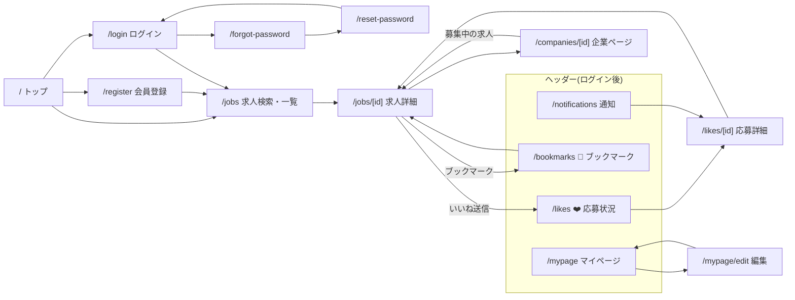
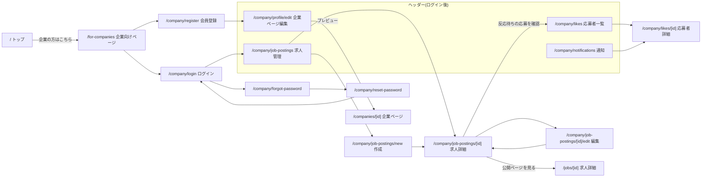

# 画面遷移図

`REQUIREMENTS.md`の機能要件をもとにした画面構成とURL案。URLは実装時に最終確定する。

## 1. 画面一覧

### 公開(ゲスト・求職者・企業の全員が閲覧可)

| URL | 画面 | 備考 |
|---|---|---|
| `/` | トップページ(求職者向け) | ヒーロー → コンセプト(3つの特徴) → 使い方(4ステップ) → 技術スタックから探す(定番の20個) → CTA。ヘッダー・フッターに「企業の方はこちら」 |
| `/for-companies` | 企業向けページ | ヒーロー → 特徴 → 使い方(5ステップ) → 掲載にあたってのお約束(7日以内の返答) → CTA。審査なしで登録できることを明記 |
| `/jobs` | 求人検索・一覧 | PCは検索サイドバー、スマホは検索条件のドロップダウン |
| `/jobs/[id]` | 求人詳細 | 求人票。求職者にはいいね(応募)・ブックマークのボタンを表示 |
| `/companies/[id]` | 企業ページ | 自己紹介〜募集中の求人までの8項目 |

### 求職者

| URL | 画面 | 備考 |
|---|---|---|
| `/register` / `/login` | 会員登録 / ログイン | |
| `/forgot-password` / `/reset-password` | パスワードリセット | |
| `/mypage` | マイページ(プロフィール閲覧) | 企業から見える内容と同じ |
| `/mypage/edit` | プロフィール編集 | 職歴・学歴・資格の追加/編集/削除もここ |
| `/likes` | 応募状況一覧 | ❤️アイコンから。いいね済 / マッチ / 不成立のタブ |
| `/likes/[id]` | 応募詳細 | 志望動機・状況。マッチ時は「企業から連絡が届きます」 |
| `/bookmarks` | ブックマーク一覧 | 🔖アイコンから。応募状況のバッジ付き |
| `/notifications` | 通知一覧 | クリックで既読化し、応募詳細へ |

### 企業

| URL | 画面 | 備考 |
|---|---|---|
| `/company/register` / `/company/login` | 会員登録 / ログイン | |
| `/company/forgot-password` / `/company/reset-password` | パスワードリセット | |
| `/company/profile/edit` | 企業ページ編集 | 閲覧は公開の`/companies/[id]`で確認する(専用の閲覧画面は作らない) |
| `/company/job-postings` | 求人管理(一覧) | 公開中件数(x / 10)・反応待ち件数の警告 |
| `/company/job-postings/new` | 求人作成 | |
| `/company/job-postings/[id]` | 求人詳細(管理) | 公開 / 募集終了 / 募集再開 / 削除(いいね0件のみ) |
| `/company/job-postings/[id]/edit` | 求人編集 | |
| `/company/likes` | 応募者一覧 | 反応待ち / マッチ / 不成立のタブ + 求人の絞り込み |
| `/company/likes/[id]` | 応募者詳細 | プロフィール・志望動機。気になる / 見送り。マッチ後はメールアドレス表示 |
| `/company/notifications` | 通知一覧 | クリックで既読化し、応募者詳細へ |

## 2. 遷移図

### 求職者

### 企業

## 3. 補足

- **会員登録後の遷移先**: 求職者は求人一覧、企業は企業ページ編集(登録直後は会社名しか入っていないため、まず企業ページを埋めてもらう)
- **いいね(応募)フォーム**: 求人詳細ページ内に表示する(志望動機の入力・通常/スーパーの選択)。別ページには分けない
- **ログインしていない状態でいいね・ブックマークを押した場合**: 画面遷移はせず、自作のモーダルで「いいね(ブックマーク)するにはログインが必要です」と表示し、「ログイン」「会員登録」「閉じる」を選ばせる(ブラウザ標準の`alert()`は見た目を変えられず選択肢も出せないため使わない)
  - ログイン・会員登録の完了後は、元の求人詳細へ戻す(`/login?redirect=/jobs/12`のように戻り先を渡す)。戻り先は自サイト内のパス(`/`始まり)のみ許可する(オープンリダイレクト対策)
  - 企業としてログイン中は、いいね・ブックマークのボタン自体を表示しない
- **公開ページのヘッダー**: `/jobs`・`/jobs/[id]`・`/companies/[id]`は、閲覧者(ゲスト / 求職者 / 企業)に応じてヘッダーを出し分ける(前作の`JobsHeader`と同じ方式)
